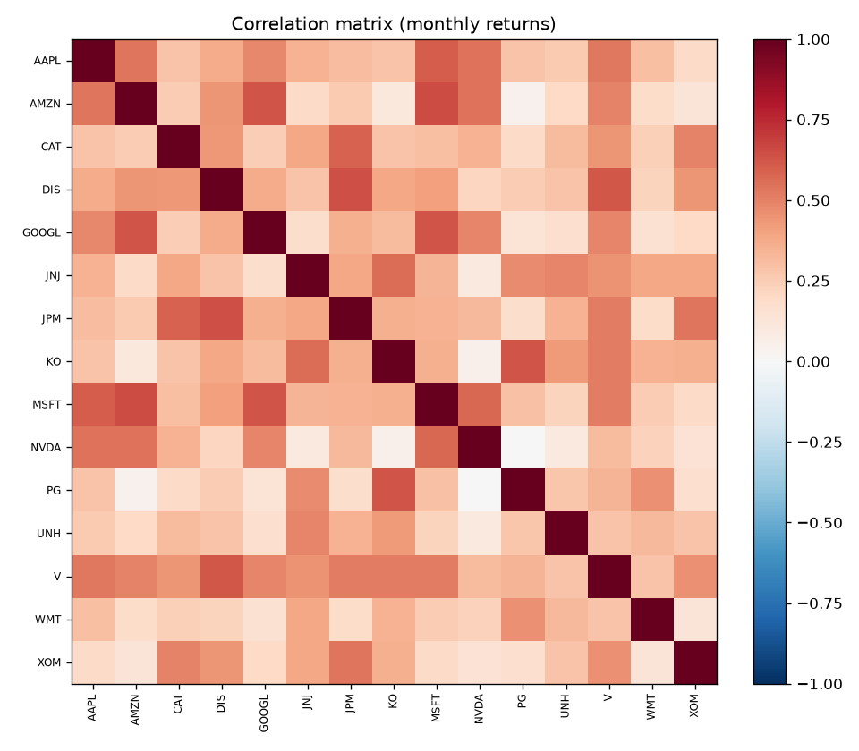
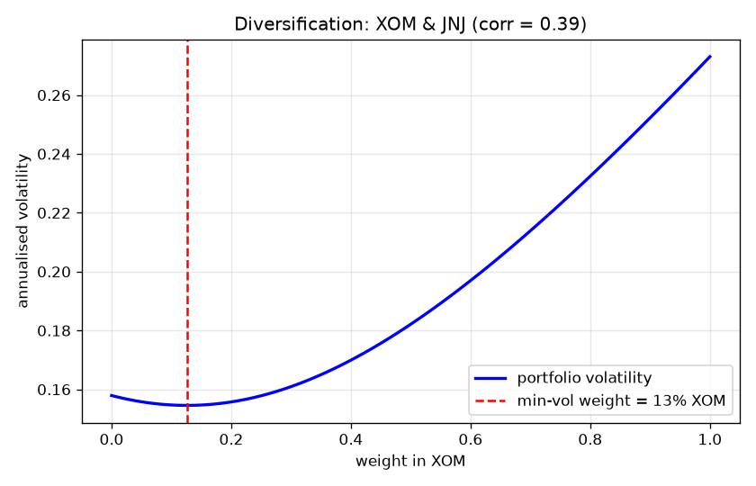
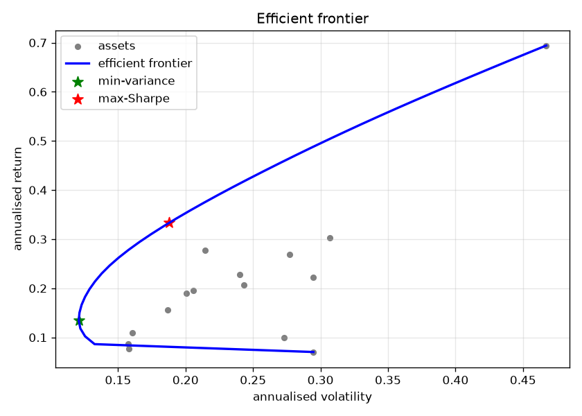
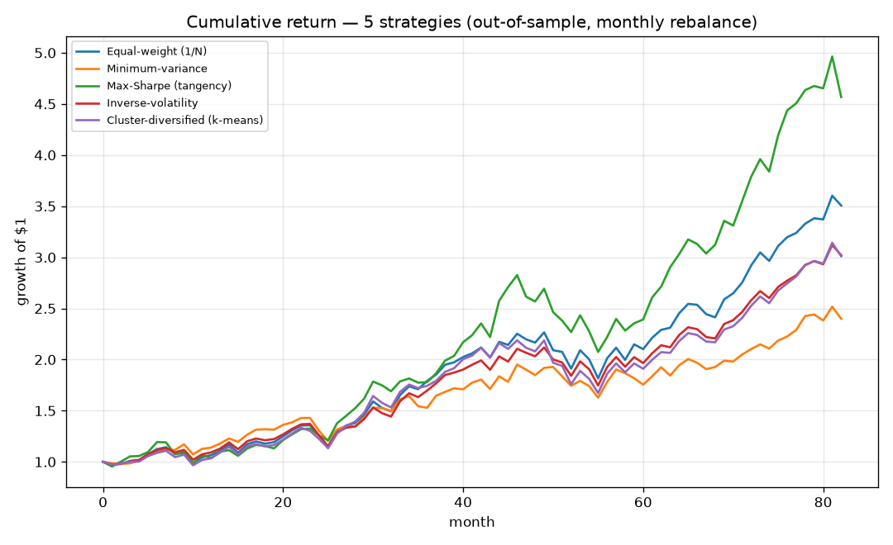
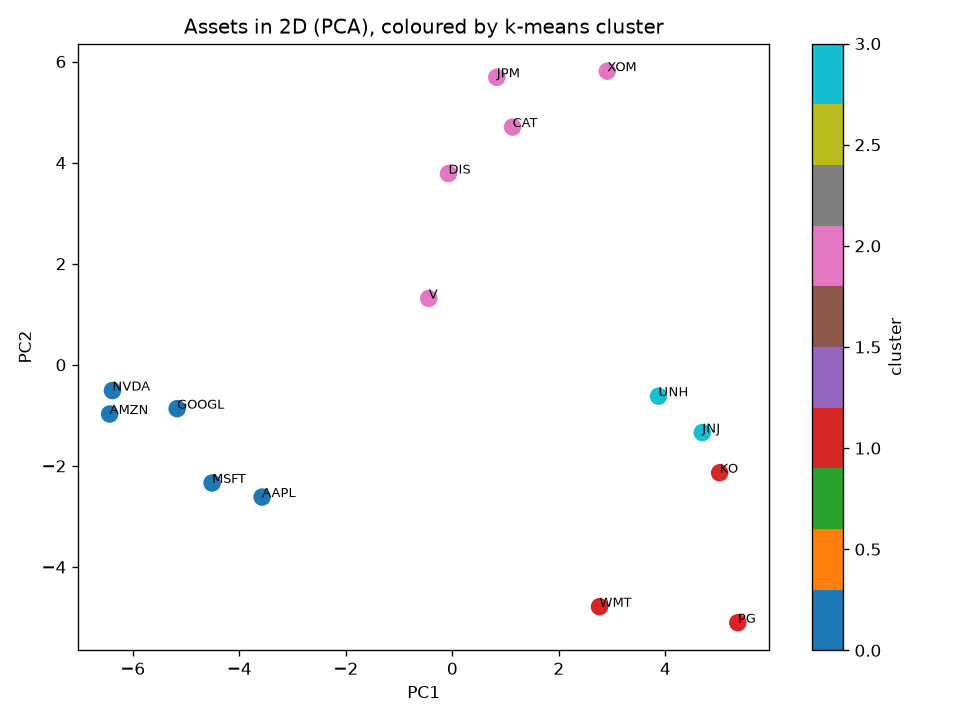

# Portfolio Optimization Using K-Means Clustering

## Project Overview
This project explores portfolio optimization using K-means clustering and Python. It analyzes a universe of 15 stocks to investigate how clustering can support diversification and portfolio construction.

## Objectives
- Analyze stock characteristics and relationships.
- Apply K-means clustering to identify groups of stocks.
- Examine portfolio diversification and concentration.
- Evaluate portfolio performance and risk-return characteristics.

## Tools and Technologies
- Python
- K-means clustering
- Financial data analysis and visualization

## Project Files
- `run_project_corrected.py` — Python analysis code
- `requirements.txt` — Required Python packages
- `figures/` — Charts and visualizations
- `results/` — Portfolio analysis results
- `report/` — Research report and supporting documentation

## Visualizations

## Running the Project
1. Install the packages listed in `requirements.txt`.
2. Run `run_project_corrected.py` using Python.
3. Review the generated outputs and project report.

## Project Documentation
See the `report/` folder for the detailed methodology, analysis, and findings.
